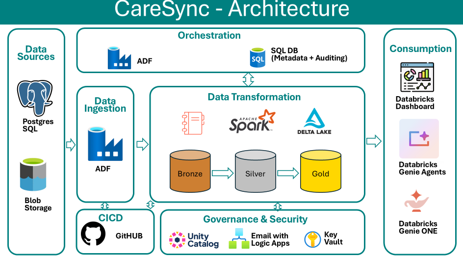

# CareSync Health Network — Metadata-Driven Data Platform on Azure & Databricks

An end-to-end healthcare data engineering project that integrates PostgreSQL and CSV data sources using Azure Data Factory and transforms data through the **Bronze, Silver, and Gold Medallion Architecture** using Azure Databricks.

## Architecture



## Project Overview

The project automates data ingestion, transformation, monitoring, and reporting using Azure services and Databricks.

### Data Flow

- **Data Sources:** PostgreSQL and CSV files.
- **Data Ingestion:** Metadata-driven pipelines using Azure Data Factory (ADF).
- **Data Transformation:** PySpark and Delta Lake with Bronze, Silver, and Gold layers.
- **Control & Auditing:** Azure SQL Database for metadata, watermarks, and audit logs.
- **Security:** Azure Key Vault, Unity Catalog, and managed identities.
- **Notifications:** Azure Logic Apps for automated success and failure emails.
- **CI/CD:** GitHub integration for Azure Data Factory and Databricks.
- **Analytics:** Databricks AI/BI Dashboards, Genie Agents, and Genie ONE.

## Key Features

- Reusable, metadata-driven data pipelines.
- Full and incremental data loading.
- Bronze, Silver, and Gold data processing.
- Automated audit logging and email notifications.
- Secure data access and credential management.
- GitHub-based version control and CI/CD workflows.
- Gold-layer reporting tables for analytics.

## Tech Stack

- **Cloud:** Microsoft Azure
- **Orchestration:** Azure Data Factory
- **Storage:** Azure Data Lake Storage Gen2
- **Processing:** Azure Databricks, PySpark
- **Data Format:** Delta Lake
- **Database:** PostgreSQL, Azure SQL Database
- **Security:** Azure Key Vault, Unity Catalog
- **Notifications:** Azure Logic Apps
- **Version Control & CI/CD:** GitHub
- **Analytics:** Databricks AI/BI, Genie

## Repository Structure

```text
caresync-Databricks-CI-CD/
├── Gold/
├── README.md
├── Workflow.png
├── CareSync Gold Insights.lvdash.json
├── landing to bronze.ipynb
└── bronze to silver.ipynb
```

## Related Repositories

- **Azure Data Factory (ADF):**  
  https://github.com/rohitmalode/caresync

- **Azure Databricks:**  
  https://github.com/rohitmalode/caresync-Databricks-CI-CD

## What I Learned

Through this project, I gained hands-on experience with metadata-driven pipelines, incremental data ingestion, PySpark transformations, Delta Lake, Medallion Architecture, audit logging, error handling, secure data access, and CI/CD workflows.

I also explored building analytics dashboards and using Databricks Genie for natural-language data analysis.

## Acknowledgment

**Special thanks to DataBeli for the tutorial, project structure, and guidance that supported my learning and implementation.

This project is part of my continued learning journey in Azure Data Engineering and Databricks.
